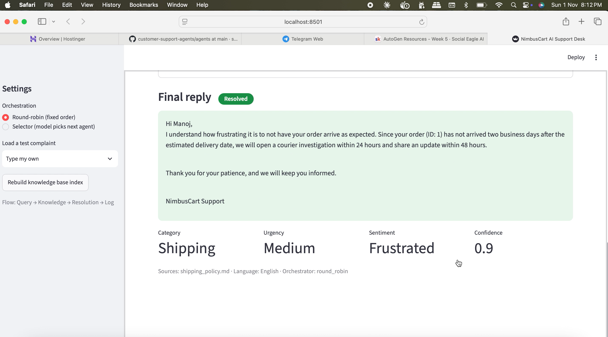
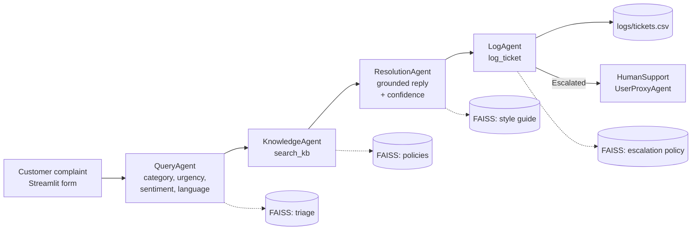

# NimbusCart AI Support Desk

A multi-agent customer support desk built with **AutoGen (v0.7 AgentChat API)**, **OpenAI**,
**FAISS** and **Streamlit**. Four agents read a complaint, find the answer in company documents,
write a grounded reply and escalate hard cases to a human, logging every ticket.

**Live demo:** <y[Streamlit cloud link ](http://localhost:8501)>
Recording link also provided as attachment in the submission portal



## Architecture



| Agent | Job | RAG source | Output |
|---|---|---|---|
| QueryAgent | Understand the complaint | triage_guidelines.md | JSON: category, urgency, sentiment, risk flags, language, summary |
| KnowledgeAgent | Retrieve relevant policy passages | 5 customer policy files | SOURCES + passages |
| ResolutionAgent | Write the reply from passages only | response_style_guide.md | REPLY + CONFIDENCE |
| LogAgent | Decide escalation, write the log row | escalation_policy.md | Status + TICKET_LOGGED |

## Key design decisions
- **Grounding:** FAISS similarity cut-off (MIN_SCORE = 0.xx, tuned on the test cases) so weak matches count
  as "no document". Sources claimed by the agent are verified against what FAISS actually returned.
- **Escalation:** the LogAgent decides using the escalation policy; a coded rule (`core/escalation.py`)
  double-checks and can only add escalations, never remove them. Covered by unit tests.
- **Termination:** `TextMentionTermination("TICKET_LOGGED", sources=["LogAgent"]) | MaxMessageTermination(12)`.

## Bonus challenges completed
- [x] Embeddings + FAISS vector store (one index per agent)
- [x] SelectorGroupChat (switch in the sidebar)
- [x] Human-in-the-loop with UserProxyAgent (Human review tab)
- [x] Dashboard (category, status, urgency, confidence, escalation reasons)
- [x] Language detection and same-language replies (Tamil, Hindi tested)
- [x] Deployed on Streamlit Community Cloud

## Setup
```bash
git clone https://github.com/srikanthai1221/customer-support-agents.git

cd customer-support-agents
python3.11 -m venv .venv && source .venv/bin/activate   # Windows: .venv\Scripts\activate
python -m pip install -r requirements.txt
cp .env.example .env        # then add your OPENAI_API_KEY
python -m rag.vector_store  # build FAISS indexes (the app also builds them on first run)
streamlit run app.py
```
Run tests: `python -m pytest -q` · Terminal run: `python cli.py "My order is late"`

## Test results (Section 8)
| # | Complaint | Expected | Got | Screenshot |
|---|---|---|---|---|
| 1 | Where is my order? It was supposed to arrive yesterday. | Shipping · Resolved | Shipping · Medium · Frustrated · **Resolved** (source: shipping_policy.md) | [view](screenshots/01_case1_late_order.png) |
| 2 | I want to return the shoes I bought last week. How do I get a refund? | Refund · Resolved | Refund & Returns · Low · Neutral · **Resolved** (source: refund_policy.md) | [view](screenshots/02_case2_return_shoes.png) |
| 3 | I forgot my password and can't log in. | Account · Resolved | Account & Login · Medium · Frustrated · **Resolved** (source: account_and_login.md) | [view](screenshots/03_case3_password.png) |
| 4 | The blender I received is broken. Can I get a replacement? | Product · Resolved | Product · Medium · Neutral · **Resolved** (source: product_faq.md) | [view](screenshots/04_case4_blender.png) |
| 5 | You charged my card three times! Fix this now or I'm contacting my bank and a lawyer. | Billing · High · Angry · Escalated | Billing & Payments · High · Angry · **Escalated**: High urgency + Angry customer + Risk: legal threat, payment dispute | [view](screenshots/05_case5_triple_charge.png) |
| 6 | Do you sell gift cards for a company of 500 employees with custom branding? | No document · Escalated | Other · Low · Neutral · **Escalated**: No matching KB document + Low confidence (0.30), honest "can't confirm" reply | [view](screenshots/06_case6_gift_cards.png) |
| 7 (own) | Forgot password, asked in Tamil | Account · Resolved · reply in Tamil | Account & Login · Medium · Neutral · **Resolved**, reply in Tamil (source: account_and_login.md) | [view](screenshots/07_own_tamil_password.png) |
| 8 (own) | Someone placed two orders from my account that I did not place. I think my account was hacked. | Account · High · fraud · Escalated | Account & Login · High · Frustrated · **Escalated**: High urgency + Risk: fraud | [view](screenshots/08_own_hacked_account.png) |

### Ticket log
![Ticket log]

## Hardest problem I solved
<2-3 sentences, e.g. tuning the similarity cut-off so case 6 escalates without breaking cases 1-5>

## Log file columns
ticket_id, timestamp, customer_name, order_id, complaint, language, category, urgency, sentiment,
summary, kb_sources, response, confidence, status, escalation_reason, orchestrator,
review_status, reviewed_by, final_response